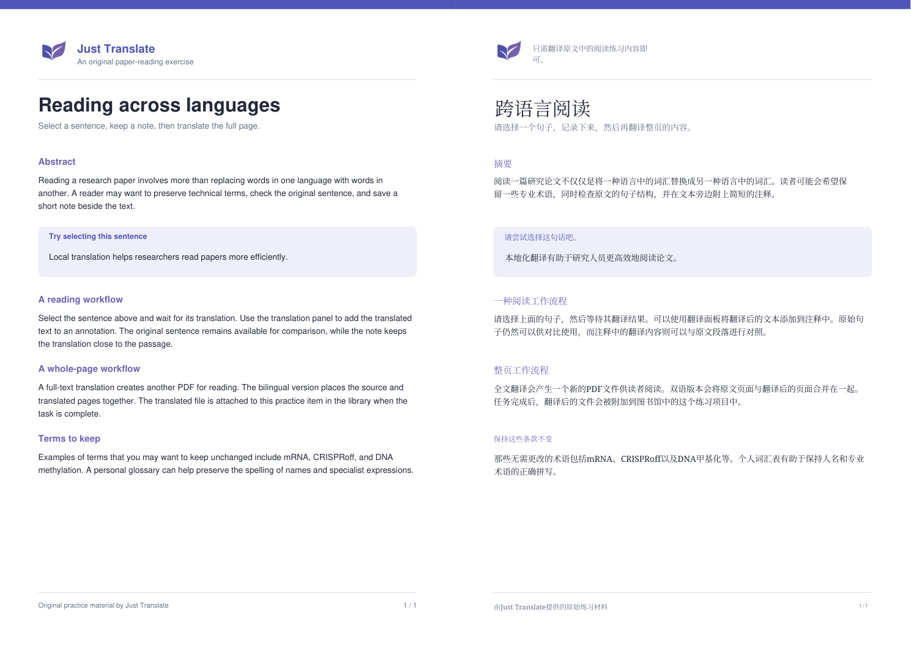

# Just Translate · 简译

**专注科研，阅读翻译交给我**

在 Zotero 中划词即译，保存译文注释，翻译整篇论文。

**首次安装 · 1.0.3 完整包**　[Mac · Apple 芯片](https://github.com/valeryzhu/just-translate-releases/releases/download/v1.0.3/Just-Translate-Installer-macOS-arm64-1.0.3.zip)　[Windows · Intel / AMD 64 位](https://github.com/valeryzhu/just-translate-releases/releases/download/v1.0.3/Just-Translate-Windows-x64-1.0.3.zip)

**只安装或更新 Zotero 插件**　[下载 1.0.3 XPI](https://github.com/valeryzhu/just-translate-releases/releases/download/v1.0.3/Just-Translate-1.0.3.xpi)

在 Zotero 打开「工具 → 插件」，把 `.xpi` 拖进插件窗口，按提示重启。首次使用简译的本地模型或全文 PDF 翻译，请按系统下载上方完整包来安装配套助手。已有兼容助手的用户可直接安装 XPI。

[查看最新版本与升级说明](https://github.com/valeryzhu/just-translate-releases/releases/latest) · [功能与使用指南](#功能) · [常见问题](#常见问题) · [反馈问题](https://github.com/valeryzhu/just-translate-releases/issues)

内置练习论文的实际输出（本地 1.0.5 验证版，HY-MT 1.8B）。左侧为原文，右侧为译文。

## 功能

| 阅读场景 | Just Translate 帮你做什么 |
| --- | --- |
| 查一个单词 | 优先使用离线 ECDICT，显示音标与释义，无需加载语言模型 |
| 读句子与段落 | 选中文字查看译文，一键加入注释，重复操作自动去重 |
| 通读整篇论文 | 生成中文与双语 PDF，处理公式、图表和双栏排版，保留原文件 |
| 连续翻译多篇 | 自动排队、逐篇处理、单项取消，结果归档到原论文下 |
| 翻译时继续阅读 | 划词优先处理，全文随后继续；展示真实进度，提示音可关闭 |
| 按学科保留术语 | 高级中设置常见标题、人名和自定义不翻译词表 |
| 选择翻译方式 | 本地 HY-MT 模型，或通过 ACP 连接已有 Agent |

主界面聚焦翻译状态、主要操作和当前任务。模型管理在「设置」，线程、输出格式与词表在「高级」。

## 三步开始

1. **安装与你电脑匹配的完整包。** 从本页顶部下载 ZIP，解压后按系统操作：
   - **Mac（Apple 芯片）** 打开「Just Translate 安装器」。当前安装器尚未完成 Apple 签名公证，macOS 可能阻止打开。安装完成后，Finder 会选中插件文件。
   - **Windows（Intel / AMD 64 位）** 双击解压目录里的 `JustTranslateSetup.exe`。助手安装完成后，资源管理器会选中插件文件。新版桌面流程待 Windows 实机复验。
   - **回到 Zotero**，进入「工具 → 插件 → 齿轮 → 从文件安装插件」，选择刚才选中的 `.xpi`，按提示重启。
2. **准备翻译方式。** 打开「工具 → Just Translate」，按电脑配置使用推荐模型，确认许可并下载。已有模型可直接启用，下载显示实际进度并支持续传。
3. **开始阅读。** 打开内置示例 PDF 或自己的论文，选中文字查看译文；点击「加入注释」保存。全文翻译从工具菜单或 PDF 文件右键进入，完成后在原论文下查看中文与双语附件。

首次准备模型、词典和 PDF 资源需要网络，完成后本地模型支持离线翻译。已有 PDF Translate 时先停用它，避免阅读器交互冲突。

## 下载与平台

| 平台 | 安装包 | 状态 |
| --- | --- | --- |
| Apple 芯片 Mac | macOS arm64 完整 ZIP | 已本机验证；尚未 Apple 开发者签名、公证 |
| Windows 10 / 11 Intel / AMD | Windows x64 完整 ZIP | CPU 推理；新版桌面流程待实机复验 |
| Zotero 7–10 | XPI 插件，需配套助手 | 7.0 与 10.0.9 有独立资料库验证记录 |
| 对应源码 | 每版 Release 的 source ZIP | 插件与助手按 AGPL-3.0-or-later 分发 |

所有下载集中在 [Releases](https://github.com/valeryzhu/just-translate-releases/releases)。当前没有 Intel Mac、Windows ARM 或 Linux 的完整安装包。

**升级：** Zotero 可自动更新插件，更新源校验 SHA-256。配套助手通过完整安装包升级；仅安装 XPI 不会升级助手。模型、论文与注释保留。具体版本要求见对应 Release 说明。

## 本地模型与已有 Agent

- **本地 HY-MT：** 可选 1.8B 或 7B，由电脑配置推荐。无需云端 API key；模型权重另行下载并确认对应许可。已下载模型可直接切换，缓存可在设置中清理。
- **已有 Agent：** 通过 ACP 使用本机配置的 Agent；依赖对应服务的账号、联网和额度，翻译文本会发给所选服务。ChatGPT / Codex 支持自动登录识别与一键连接，无需手填路径。
- **词典：** 单个英文单词直接查离线 ECDICT；未收录时明确提示，句段仍走模型。首次额外下载约 66 MB 并建立索引。

## 高级设置

「高级」中调整处理线程、双语与中文输出、常见标题与人名保留，以及不翻译词表。每行填写一个专有词，区分大小写。人名识别可能遗漏，重要名称可加入词表。每项全文任务使用提交时的设置。

「保留参考文献原文」按独立 References 等标题识别，默认关闭，只影响全文翻译，划词仍可翻译。支持常见双栏和跨页；复杂布局可能漏保留。新开关需要新版配套助手，旧助手仍可保存原有设置。

## 常见问题

### 安装 XPI 后，为什么助手未连接？

XPI 是 Zotero 内的操作入口，配套助手负责模型和 PDF 处理。首次安装请下载系统对应的完整 ZIP，运行安装器、安装包内 XPI，然后重启 Zotero。

### 支持扫描件或其他语言吗？

当前流程为英文译成简体中文，适用于有文字层的 PDF。扫描件需先 OCR。全文引擎处理公式、表格和双栏，效果随文档变化；术语、否定句和数值关系建议用双语版核对。

### 全文翻译时还可以划词吗？

可以。本地模型优先处理划词，之后继续全文；多个全文任务逐篇处理。Agent 模式在请求边界调度，延迟同时取决于相应服务。

### 下载失败或想切换模型，怎么办？

在设置中重新检测、继续下载或切换已有模型。支持续传与完整性校验。清理缓存前先切换出当前模型，翻译或下载期间暂停清理。

### 使用 ChatGPT Plus 是否等于无限翻译？

Agent 连接使用对应账号实际可用的权限与额度。ChatGPT / Codex 登录由官方 CLI 管理，插件不收集登录凭据。本地 HY-MT 模式使用电脑资源，无需云端订阅。

### 如何反馈问题？

在 [公开仓库 Issues](https://github.com/valeryzhu/just-translate-releases/issues) 说明系统、Zotero 版本、插件与助手版本、复现步骤和错误提示。插件「设置 → 交流与反馈」提供 QQ 群与「小竹读研在养鱼」公众号二维码。

## 来源与许可

- [Translate for Zotero](https://github.com/windingwind/zotero-pdf-translate)：划词和阅读器交互基础，AGPL-3.0-or-later。
- [PDFMathTranslate-next](https://github.com/PDFMathTranslate/PDFMathTranslate-next) 与 BabelDOC：全文解析与排版。
- [Zotero PDF2zh](https://github.com/guaguastandup/zotero-pdf2zh)：全文工作流参考。
- [HY-MT](https://github.com/Tencent-Hunyuan/HY-MT)：本地翻译模型，分别遵守模型许可。
- [llama.cpp](https://github.com/ggml-org/llama.cpp)：本地推理运行时。

插件与助手按 AGPL-3.0-or-later 分发。完整许可证、原项目说明与第三方声明随每个 Release 的对应源码和安装包提供；模型许可在下载前展示。
